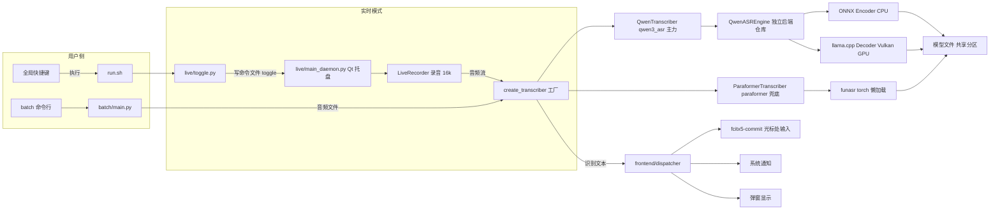

# voice_toolkit — 本地语音转文字(实时 + 批量)

按住快捷键说话 → 松手 → 文字出现在光标处。全本地推理,无网络依赖,支持 AMD GPU(Vulkan)。

内置两条模型路线:

| 路线 | 模型 | 精度(CER) | 速度(RTF) | 状态 |
|:---|:---|:---|:---|:---|
| **主力** | Qwen3-ASR-1.7B(GGUF 混合格式) | **0.56%** | **0.04**(远超实时) | ✅ 推荐 |
| 兜底 | SeACo-Paraformer / Paraformer-large | 7.68% / 11.42% | 0.14~0.19 | 备用 |

## 架构



**推理分工**(Qwen3-ASR 混合格式):
- **Encoder**(ONNX,int4)— CPU 即可,计算量极小
- **Decoder**(GGUF q4_k)— llama.cpp **Vulkan GPU** 加速
- 实测(9600X + RX 9060 XT):RTF 0.04,即 1 分钟音频约 2.4 秒转完

## 目录结构

```
voice_toolkit/
├── run.sh               # 实时模式入口(录音/转录切换, 建议绑全局快捷键)
├── live/                # 实时: toggle.py 触发 → main_daemon.py 托盘守护进程
│   ├── toggle.py        #   检查/拉起 daemon, 转发"toggle"命令, 输出结果
│   ├── main_daemon.py   #   Qt 托盘 + 录音/转录状态机(命令文件驱动)
│   └── recorder.py      #   录音(16k 单声道 int16)
├── batch/main.py        # 批量: 目录内所有音频 → txt
├── core/                # 核心: 转录器 + 工厂 + 音频工具
│   ├── models.py        #   QwenTranscriber / ParaformerTranscriber
│   ├── create_transcriber.py  # 按配置 model 分发
│   └── transcribe_base.py
├── frontend/            # 输出: dispatcher → fcitx5/通知/弹窗
│   └── fcitx5.py        #   写 /tmp/voxtype, 由 fcitx5 插件提交
├── fcitx5-commit/       # 可选: fcitx5 插件(光标处输入), C++ 需编译
├── config/
│   ├── config.py        # 配置类(内置默认值 + 读 ~/.config)
│   └── config.example.yaml  # ⚠️ 模板文件! 部署参照它, 不生效
├── requirements.txt     # Python 依赖(注意 torch 要 CPU 版, 见部署)
└── DEVELOPMENT_LOG.md   # 开发日志(含全部踩坑记录)
```

## 部署

### 0. 前置

- Linux + Python **3.12**
- AMD 显卡走 **Vulkan**(NVIDIA 亦可);模型推理完全本地

### 1. 克隆两个仓库

```bash
git clone <本项目> && cd voice_toolkit

# Qwen3-ASR 推理后端(独立仓库, 可单独 git pull 更新)
git clone https://github.com/HaujetZhao/Qwen3-ASR-GGUF.git ~/Public/Qwen3-ASR-GGUF
```

### 2. Python 依赖

```bash
python3.12 -m venv venv
venv/bin/pip install -r requirements.txt

# ⚠️ AMD 机器必做: 换 CPU 版 torch(requirements 默认是 CUDA 版, AMD 上 import 即崩)
venv/bin/pip install --index-url https://download.pytorch.org/whl/cpu torch

# 后端仓库需要 onnxruntime(Linux 用标准版, 别用后端 README 的 directml 版)
venv/bin/pip install onnxruntime
```

### 3. llama.cpp 系统库(qwen3_asr Decoder 用)

```bash
# Arch / CachyOS:
sudo pacman -S ggml ggml-cpu ggml-vulkan llama-cpp

# 然后把库"冻结"到后端目录, 防止系统升级导致翻译层失效:
sudo cp /usr/lib/libggml.so* /usr/lib/libggml-base.so* /usr/lib/libllama.so* \
        ~/Public/Qwen3-ASR-GGUF/qwen_asr_gguf/inference/bin/
```

> ⚠️ llama.py(后端仓库内)是 ctypes 翻译层, 与 llama.cpp 版本**强耦合**——升级系统库后若引擎初始化失败(返回 NULL), 需同步检查该文件的结构体定义。

### 4. 模型文件

**qwen3_asr 三件套**(≈1.4GB,放共享分区双系统共用为佳):

```bash
mkdir -p /mnt/shared/Models/qwen3-asr-gguf
# 放入 3 个文件:
#   qwen3_asr_encoder_frontend.int4.onnx
#   qwen3_asr_encoder_backend.int4.onnx
#   qwen3_asr_llm.q4_k.gguf
```

**paraformer**(可选兜底,4 件,iic 命名目录)— 放 `/mnt/shared/Models/iic/` 下。

### 5. 配置

```bash
mkdir -p ~/.config/voice_toolkit/hotwords
cp config/config.example.yaml ~/.config/voice_toolkit/config.yaml
# 编辑: 核对模型路径 / 选择 live、batch 的 model / 热词 context
```

### 6. 热词(可选, 专业术语场景强烈推荐)

在 `~/.config/voice_toolkit/hotwords/` 放一个文本文件(支持 Markdown),配置里 `context: 文件名.txt` 即可。内容会被当作上下文提示喂给模型,提升术语准确率。填 `0` 或留空关闭。

## 使用

### 实时模式

```bash
./run.sh        # 或在桌面环境把 run.sh 绑到全局快捷键
```

- 按一次 = **开始录音**(托盘图标变化);再按一次 = **停止并转录**
- 转录文本自动输出到光标处(fcitx5 插件)/ 通知 / 弹窗(由 `output_mode` 决定)
- 转录中再按会提示"正在转录中"

**光标输出需装 fcitx5 插件**(可选):

```bash
sudo pacman -S fcitx5 fcitx5-dev  # 依赖
cd fcitx5-commit && cmake -B build && sudo cmake --install build
# 重启 fcitx5 后插件生效
```

### 批量模式

```bash
venv/bin/python batch/main.py -i <音频目录> -o <输出目录>
# 目录内所有音频 → 同名 .txt(自动转 16k wav)
```

## 配置速查

| 键 | 作用 |
|:---|:---|
| `live.model` / `batch.model` | 用哪个模型(`qwen3_asr` / `paraformer_v1` / `paraformer_v2`) |
| `models.<名>.dir` | 模型目录 |
| `models.qwen3_asr.params.context` | 热词文件名(见上) |
| `output_mode` | `cursor`(光标输入)/ `notification` / `window` |
| `idle_timeout_sec` | 空闲释放模型秒数(0 = 常驻, 省启动延迟) |

完整字段及注释见 [`config/config.example.yaml`](config/config.example.yaml)。

## 常见问题

- **`daemon 启动失败: (超时)`** → 检查 `live/toggle.py` 等待锁的超时(旧代码 5s,已放宽 20s);慢机器上首次 import 很慢。
- **torch 导入报 `libcudart.so.13 not found`** → 装成 CUDA 版了,按部署第 2 步换 CPU 版。
- **转录全空 / 引擎返回 NULL** → llama.cpp 库与后端翻译层版本不匹配,重新"冻结"库(部署第 3 步)。
- **模型在 NTFS 共享分区找不到** → 确认挂载:`mount | grep /mnt/shared`;重启后未自动挂载需配置 fstab。

更多历史踩坑见 [`DEVELOPMENT_LOG.md`](DEVELOPMENT_LOG.md)。

## Windows?

本项目的后端(Qwen3-ASR-GGUF)在 Windows 上原生支持(DirectML),模型已放共享分区(NTFS)双系统共用。Windows 侧需要:Python 环境 + 复制本项目 + 重写 `frontend/fcitx5.py` 的输出为 Windows 光标注入(如 SendInput)。详见仓库 docs(规划中)。
